# GIS Service Management System — User Manual (English)

## 1. Quick Start (Database Already Ready)

Use this when PostgreSQL / PostGIS and the initialization SQL are already in place and you only need to bring the services up. Four steps from a fresh install to the admin UI.

> Prerequisites: the `mapserver-manager` database has been created and initialized; this software is installed (or the `run-env` directory with `bin`, `config`, and `share\proj` is available).

1. **Edit `.env`**: open `.env` in the installation directory with a text editor and check:
   - `MANAGER_DB_PASSWORD` and `MAPSERVER_DB_PASSWORD`: the actual password of the PostgreSQL `postgres` user (same value in both).
   - `MANAGER_DB_PORT` and `MAPSERVER_DB_PORT`: set both to the PostgreSQL port `5432`.
   - `MANAGER_JWT_SECRET`: randomly generated by the installer; leave it unchanged.
2. **Start the map engine**: double-click `start-mapserver.bat` in the installation directory. `Starting mapserve on port 8080...` means it is running.
3. **Start the admin UI**: double-click `start-manager.bat`. `Starting manager on port 6180...` means it is running.
4. **Sign in**: open `http://localhost:6180/` in a browser (the trailing slash is required) and sign in with the default admin account `admin` / `admin123`. Change the password after the first login.

> If you selected "Register as Windows service" during installation, skip steps 2 and 3: both services are set to start automatically; you can also start `mapserve` and `map-manager` manually in Services.

To stop: close the two bat windows, or stop the corresponding services in Services.

---

## 2. Overview

This system manages the map data catalog, publishes data services, monitors service health, and provides user and permission management. It is a browser-based (B/S) application: all operations can be performed from the administration UI.

- URL: `http://<server>:6180`
- Sign in with the account assigned by your administrator
- Layout:
  - Top bar: notifications, theme, fullscreen, language switch, current-user menu
  - Left sidebar: function modules, collapsible
  - Tabs: opened pages for quick switching
  - Content area: the current page

> Note: Organization names in the screenshots are masked as `**` to protect data.

---

## 3. User Management

**Menu: System Administration → User Management**

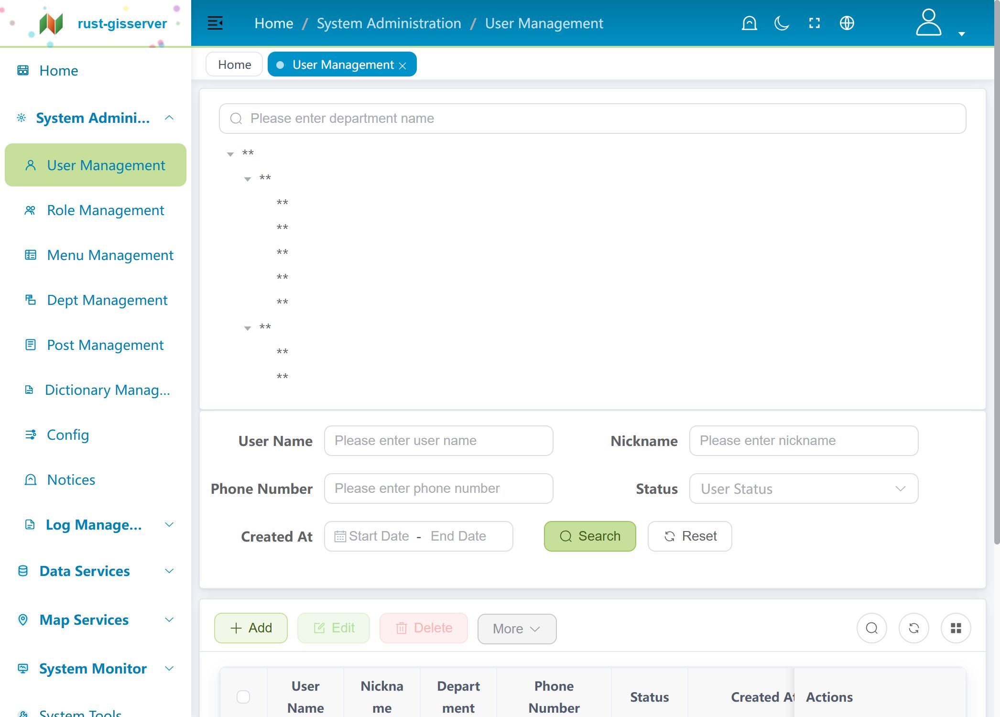

User Management maintains system accounts and assigns departments, posts, and roles.

- Left: department tree; click a department to filter its users
- Search filters: username, nickname, phone, status, created-time range
- Toolbar: Add, Edit, Delete, More (import/export), search toggle, column settings
- User list: username, nickname, department, phone, status, created time, actions

Common tasks:

1. **Search**: set filters and click "Search"; click "Reset" to clear them.
2. **Add**: click "Add", fill in username, nickname, password, department, phone, email, gender, status, posts, roles, and remark; click "OK".
3. **Edit / Delete**: select rows and click "Edit" or "Delete"; row actions are also available.
4. **Import / Export**: "More → Download Template"; "Import Data" accepts `.xlsx/.xls` with an optional "update existing data" flag; "Export Data" exports the current list.
5. **Reset password**: choose "Reset Password" in the row actions and enter the new password.

Validation: username, nickname, and password are required; password length 5–20; phone must be a valid mainland China mobile number; username and password must not contain `< > " ' \ |`.

---

## 4. Data Services

The Data Services module registers workspaces, data sources, and layers, and publishes layers as accessible map services. The principle is "register pointers, never copy data".

### 4.1 Data Catalog

**Menu: Data Services → Data Catalog**

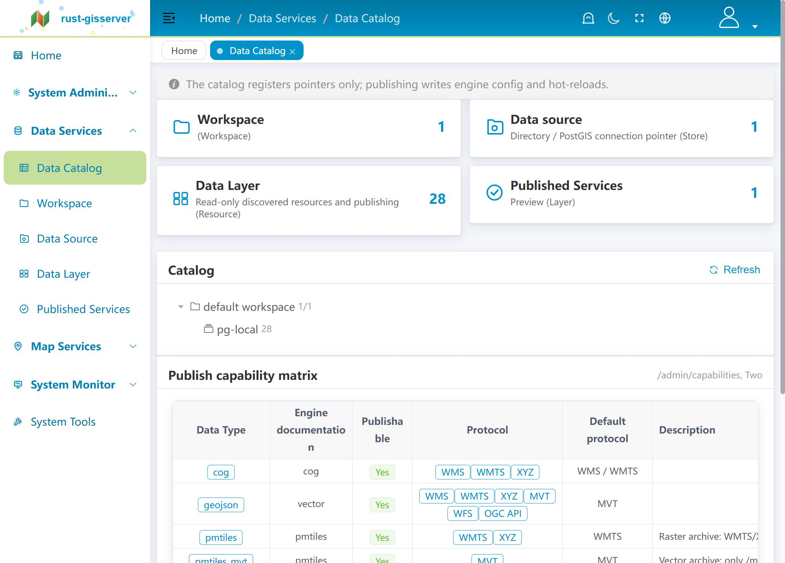

- Displays the hierarchy of workspaces, data sources, and layers as a tree
- The catalog registers pointers only; publishing writes engine configuration and triggers a hot reload
- Supports refreshing the catalog and maintaining or deleting catalog nodes
- Jump quickly to a workspace or layer from the tree

### 4.2 Workspace

**Menu: Data Services → Workspace**

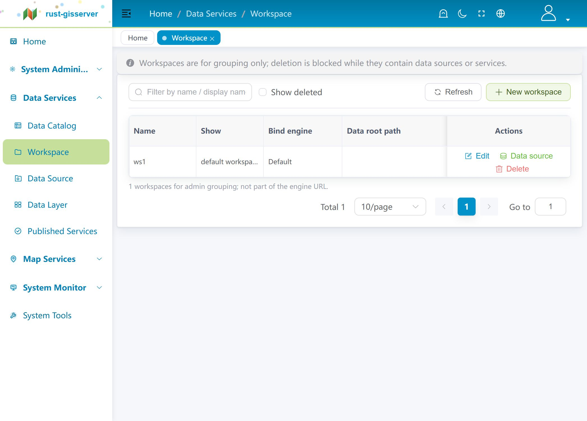

- Workspaces are for grouping only; a workspace cannot be deleted while it still contains data sources or services
- The built-in **default workspace** (`ws1`) is bound to the default engine; existing services and unassigned data belong to it
- List fields: name, display name, bound engine, data root path
- Actions: filter by name/display name, show deleted, refresh, create workspace, edit, view data sources, delete

### 4.3 Data Source

**Menu: Data Services → Data Source**

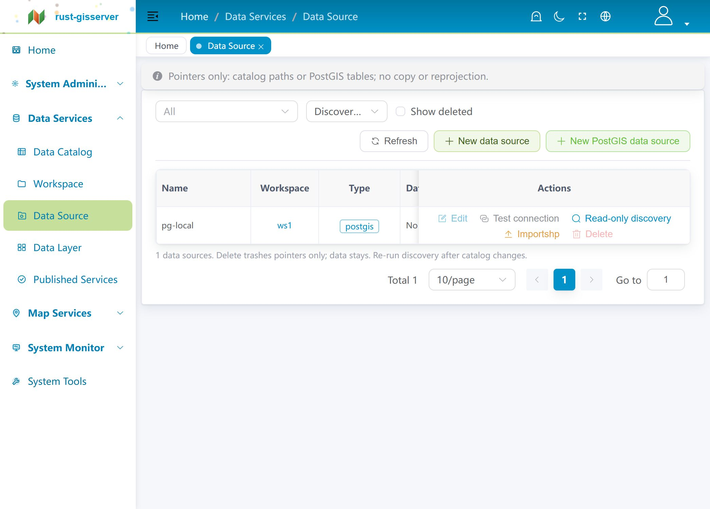

- Registers pointers only; data is neither copied nor reprojected
- Filter by workspace; set "Discovery Depth" to control how many levels of tables/layers are discovered
- Optionally show deleted data sources for recovery or cleanup
- Common types: local directories (Shapefile, GeoPackage, COG, etc.), PostGIS databases, tables created by SHP import
- Actions: add a data source, test connection, discover tables, edit, delete

> Note: For PostGIS, provide a correct host, port, database, username, and password, and choose the CRS that matches the data.

### 4.4 Data Layer

**Menu: Data Services → Data Layer**

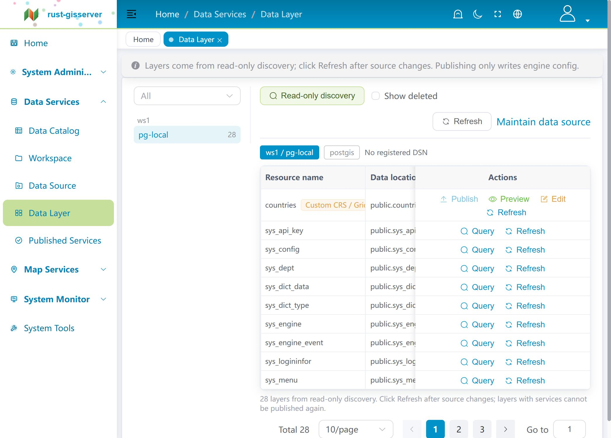

- Layers are generated by read-only discovery; click "Refresh" after the source file or table changes
- Filter by space/workspace and inspect layer metadata (geometry type, CRS, fields, etc.)
- Publishing a layer only writes engine configuration; source data is untouched
- Configure styles (SLD / MVT style) before publishing as MVT, WMS, or WFS services

### 4.5 Published Services

**Menu: Data Services → Published Services**

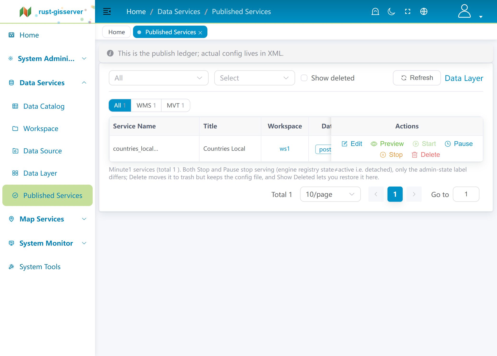

- Shows the publish ledger; the actual service configuration lives in engine XML files
- Filter by workspace, show deleted entries, and refresh the list
- Review service URL, service type, and publish time
- Perform lifecycle actions such as taking a service offline, restoring it, or deleting it

---

## 5. Map Services

The Map Services module shows service health and manages published services and related resources (styles, cache, engines, API keys, etc.).

### 5.1 Operations Dashboard

**Menu: Map Services → Operations Dashboard**

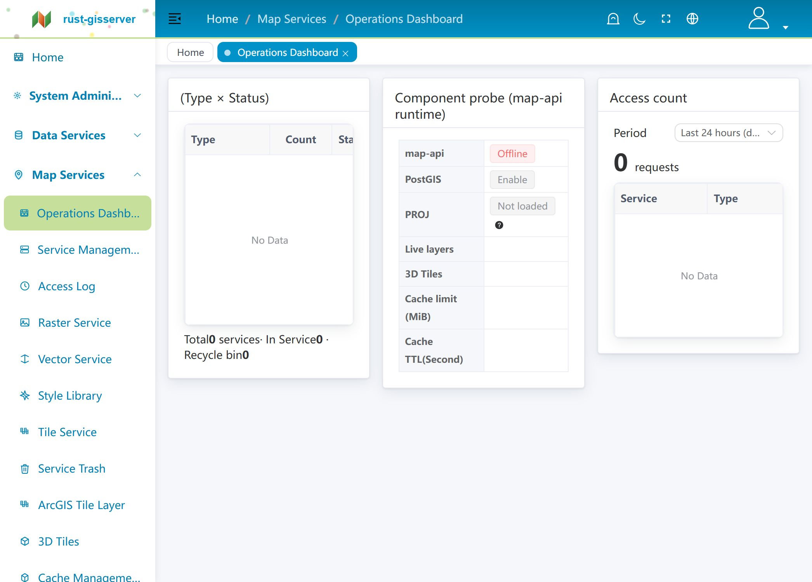

- **Service statistics (Type × Status)**: counts and status distribution by service type
- **Component probes**: map-api liveness, PostGIS, PROJ reprojection, in-service layers, 3D Tiles services, cache limit, and cache TTL
- **Access count**: request volume over the selected period

### 5.2 Service Management

**Menu: Map Services → Service Management**

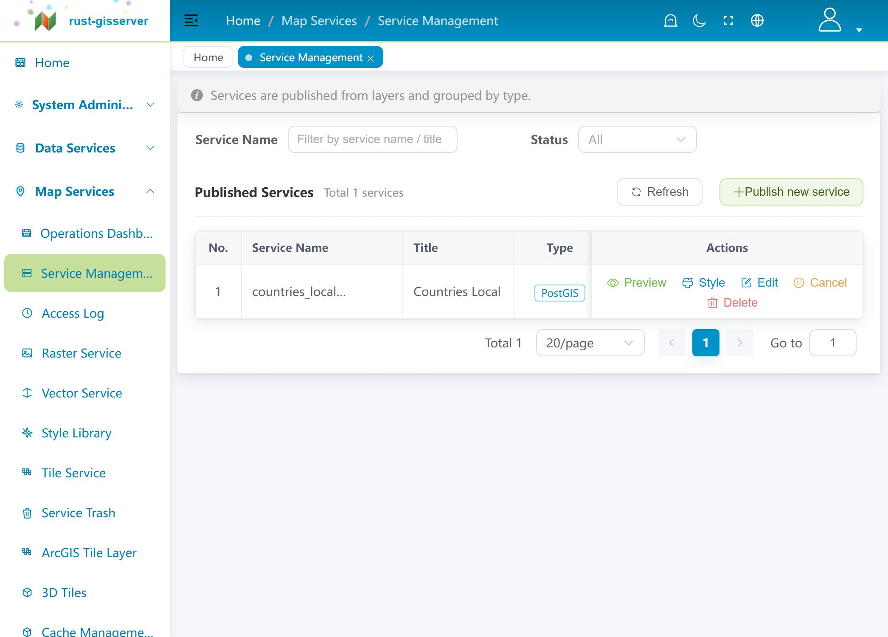

- Services are published from data layers and displayed by type
- Filter by service name and status
- Actions: enable/disable, reload configuration, view configuration, preview, access statistics, health check

### 5.3 Raster Service

**Menu: Map Services → Raster Service**

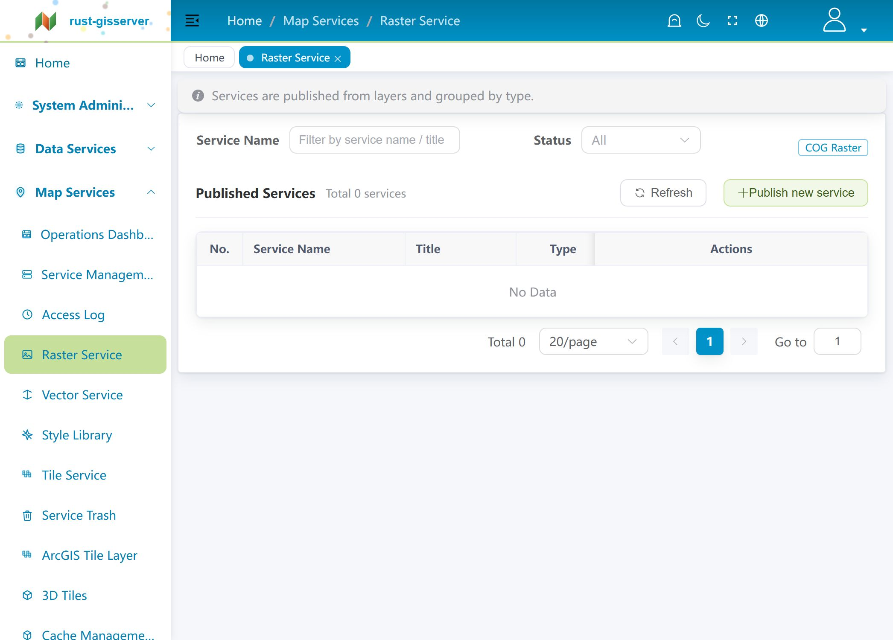

- Displays COG and other raster services using the same layout as Service Management
- Filter by service name and status
- Supports preview, reload, configuration viewing, and offline actions

### 5.4 Access Log

**Menu: Map Services → Access Log**

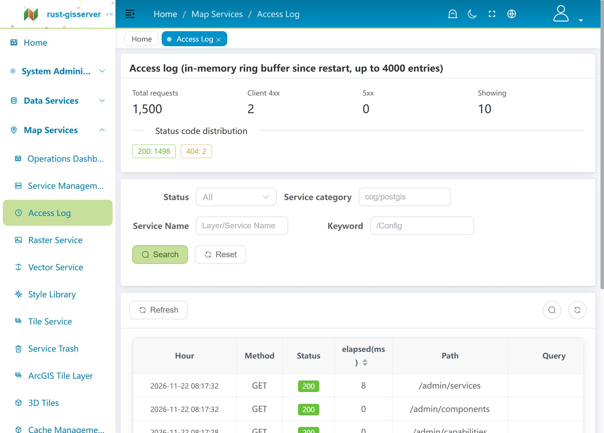

- Access logs are kept in an in-memory ring buffer (cleared on restart, max 4000 entries)
- Shows cumulative requests, per-service request statistics, and recent access details
- Supports filtering, refreshing, and clearing logs
- Useful for diagnosing call volume, response status, and access sources

### 5.5 Style Library

**Menu: Map Services → Style Library**

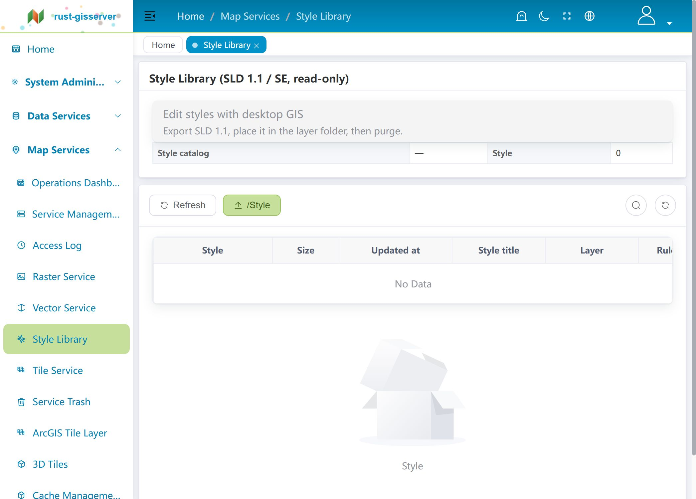

- Manages SLD 1.1 / SE styles used for WMS rendering and legends
- Recommended workflow: use a desktop GIS tool → Layer → Style → Export SLD 1.1, place it back in the layer folder, then purge/reload
- Supports browsing the style catalog, previewing content, importing/updating, and deleting styles
- SLD affects WMS raster rendering and legends only; it does not change MVT tile content

### 5.6 Vector Service

**Menu: Map Services → Vector Service**

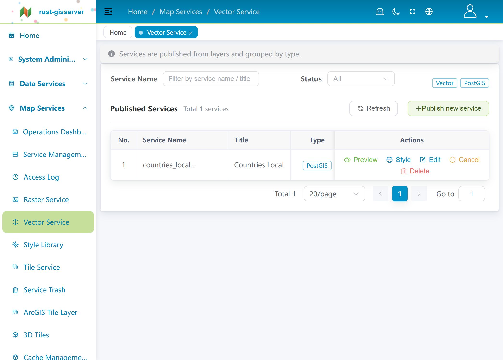

- Displays vector services (MVT / WMS / WFS)
- Filter by service name and status
- Supports preview, reload, configuration viewing, and offline actions

### 5.7 Service Trash

**Menu: Map Services → Service Trash**

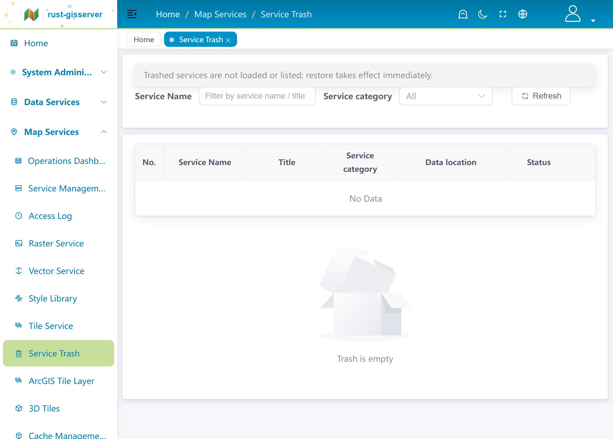

- Trashed services are not loaded or displayed; restoring takes effect immediately
- Filter by service name and service type; refresh the list
- List fields: service name, title, service type, data location, registration status
- Restore or permanently delete trashed services

### 5.8 Tile Service

**Menu: Map Services → Tile Service**

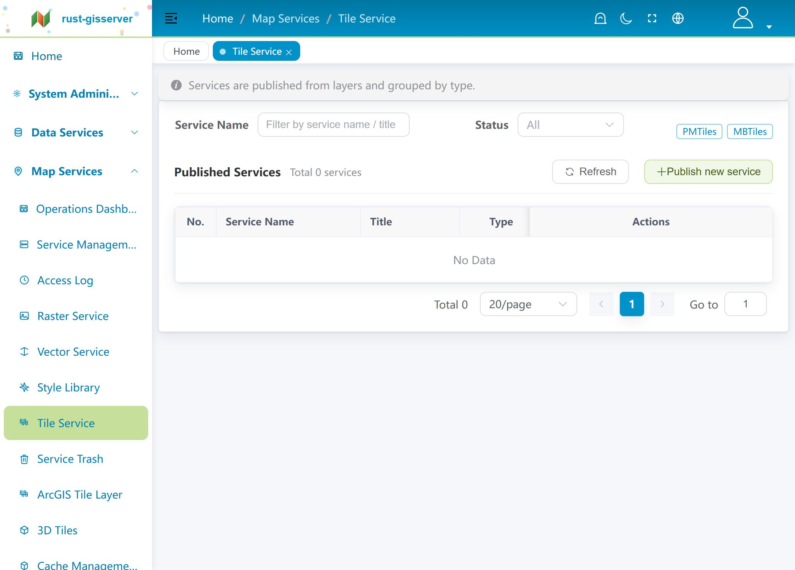

- Displays PMTiles / MBTiles and other tile services
- Filter by service name and status
- Supports preview, reload, configuration viewing, and offline actions

### 5.9 ArcGIS Tile Layer

**Menu: Map Services → ArcGIS Tile Layer**

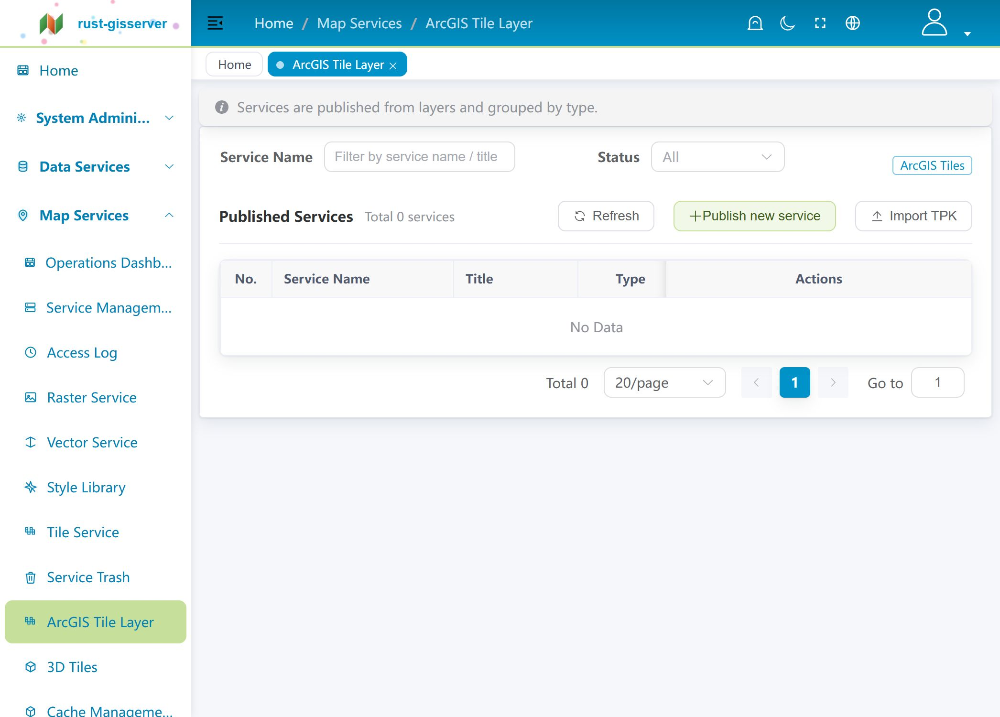

- Manages integrated ArcGIS tile layer services
- Filter by service name and status
- Supports preview, reload, configuration viewing, and offline actions

### 5.10 3D Tiles

**Menu: Map Services → 3D Tiles**

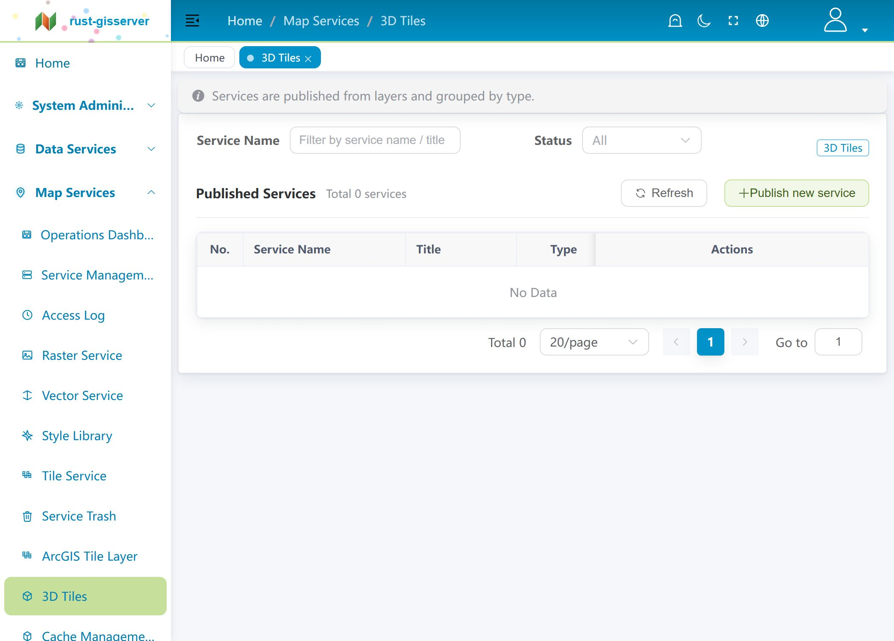

- Manages 3D Tiles services (photogrammetry, BIM, and other 3D datasets)
- Filter by service name and status
- Supports preview, reload, configuration viewing, and offline actions

### 5.11 Runtime Configuration

**Menu: Map Services → Runtime Configuration**

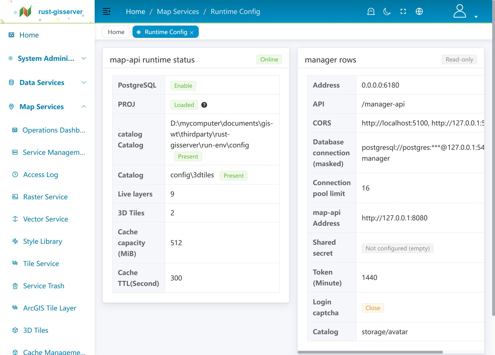

- Left: **map-api runtime status** — PostgreSQL, PROJ projection, catalog root, tile directory, in-service layers, 3D Tiles services, cache capacity, and TTL
- Right: **manager runtime configuration** (read-only) — listen address, API prefix, CORS allowlist, data-source connection (password masked), pool limit, map-api base URL, shared secret, and token settings
- Addresses and secrets are maintained in `config/manager.xml` and `config/mapserver.xml`; online editing is not provided

### 5.12 Cache Management

**Menu: Map Services → Cache Management**

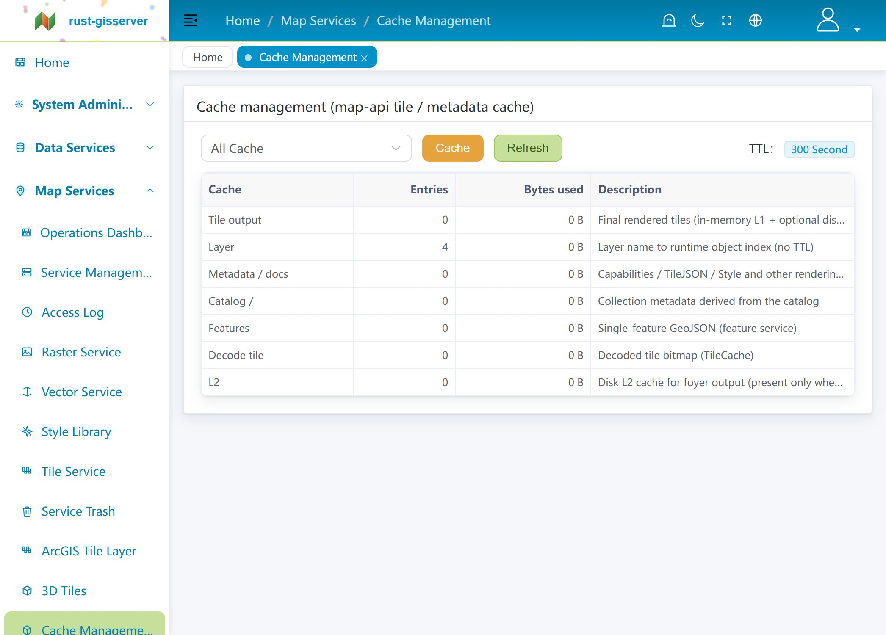

- Shows map-api tile/metadata cache zones: tile output, layer index, metadata/docs, catalog/collection, feature, decoded tiles, and disk L2
- Columns: cache zone, entry count, bytes used, description
- Supports filtering by zone, clearing the cache, refreshing statistics, and shows the current TTL

### 5.13 Service Engine Management

**Menu: Map Services → Service Engine Management**

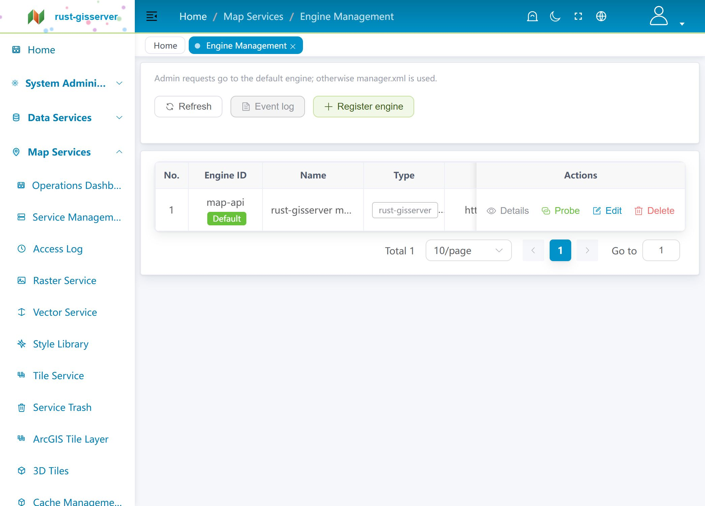

- Admin requests are forwarded to the default engine; when unset, `manager.xml` is used
- Columns: engine ID, name, type, URL
- Actions: view details, probe connectivity, edit, delete; also register a new engine and view the event log
- `map-api` is the built-in default engine

### 5.14 API Key Management

**Menu: Map Services → API Key Management**

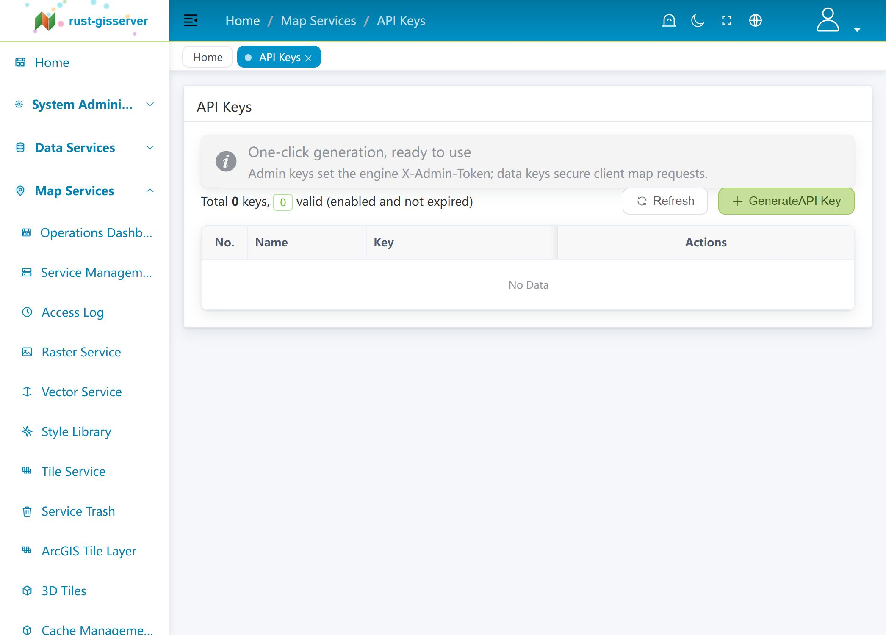

- One place to generate keys with two usages:
  - `admin Key`: sent as the `X-Admin-Token` header for admin APIs
  - `data Key`: used by clients to access map services
- Generate, enable/disable, and delete API keys
- The list shows name, key, status, and validity; only "enabled and not expired" keys are counted as valid

---

## 6. System Monitor

### 6.1 Online Users

**Menu: System Monitor → Online Users**

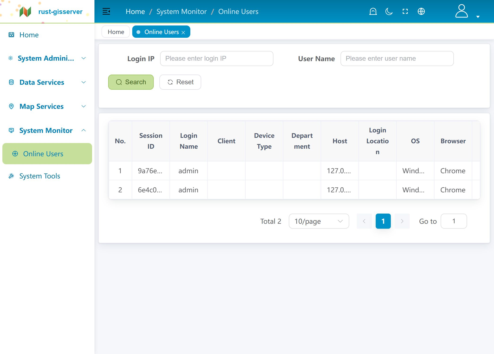

- Lists active sessions: session ID, login name, client, login IP, and login time
- Filter by login IP and user name
- Force a single session offline, or select multiple rows and force logout in batch

### 6.2 Operation Log

**Menu: System Administration → Log Management → Operation Log**

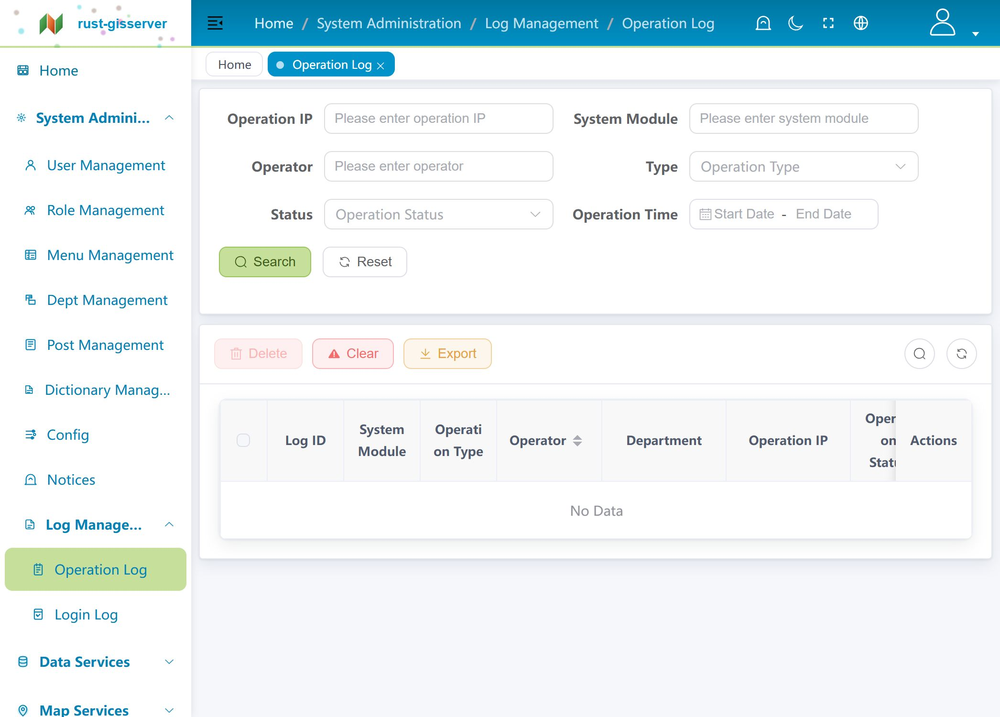

- Records key operations: operation IP, system module, operator, operation type, status, and time
- Supports filtered queries, detail viewing, deletion, and export

### 6.3 Login Log

**Menu: System Administration → Log Management → Login Log**

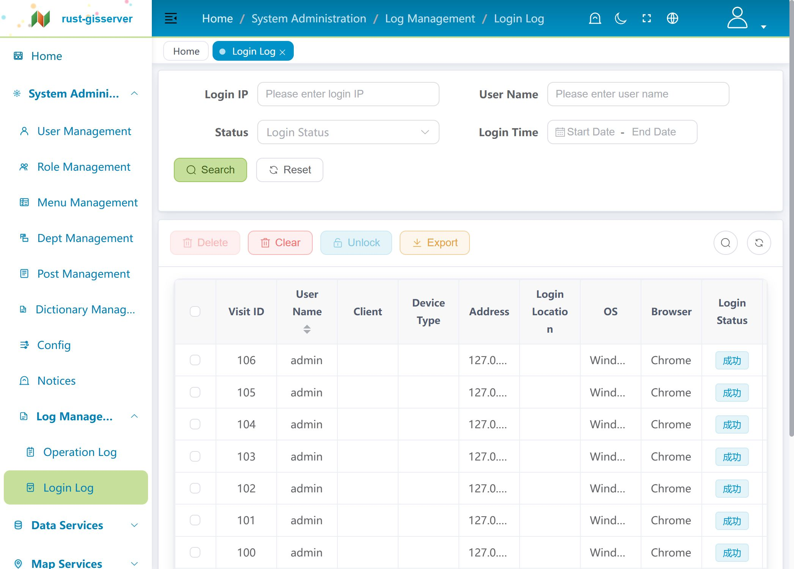

- Records successful and failed sign-ins: login IP, user name, status, and time
- Supports query, delete, clear, and export
- Use "Unlock" to unlock an account locked after failed password attempts

---

## 7. General Operations and Tips

1. **Language switch**: Use the globe icon to switch between Chinese and English; menus and page text update immediately.
2. **Fullscreen**: Click the fullscreen icon to enter fullscreen; click again to exit.
3. **Theme**: Use the moon/sun icon to toggle light and dark themes.
4. **Tabs**: Click a tab to switch pages; right-click to close the current tab or others.
5. **User menu**: Click the avatar in the top-right corner for Profile, Layout Settings, or Sign Out.
6. **Applying configuration**: After editing layer or service configuration, run "Reload" in Service Management (or use the hot-reload capability) so changes take effect immediately.
7. **Data safety**: Before deleting a data source, layer, or service, check references and back up configuration when necessary.
