# 地图服务管理系统 功能使用手册（中文版）

## 1. 系统概述

本系统用于管理地图数据目录、发布数据服务、监控服务运行状态，并提供用户与权限管理。系统采用 B/S 架构，使用浏览器访问管理端即可完成全部操作。

- 访问地址：`http://<服务器地址>:6180`
- 登录方式：使用管理员分配的账号登录
- 界面布局：
  - 顶部导航栏：通知、主题切换、全屏、语言切换、当前用户菜单
  - 左侧菜单：按功能模块分组，可折叠
  - 标签页：记录已打开的页面，可快速切换
  - 内容区：当前功能页面

> 说明：为保护数据，本手册截图中涉及的组织架构名称已统一脱敏为 `**`。

---

## 2. 用户管理

**菜单路径：系统管理 → 用户管理**

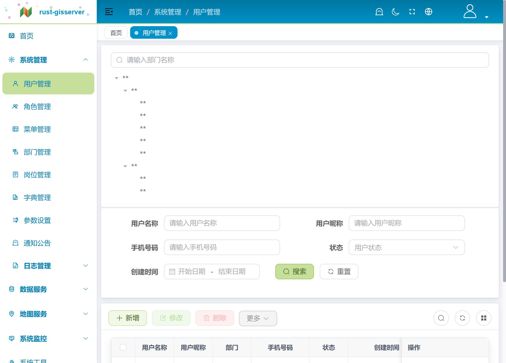

用户管理用于维护系统登录账号，并为账号分配部门、岗位与角色。

- 左侧部门树：点击部门筛选该部门下的用户
- 查询条件：用户名称、用户昵称、手机号码、状态、创建时间范围
- 工具栏：新增、修改、删除、更多（导入/导出）、搜索显隐、列设置
- 用户列表：用户名称、昵称、部门、手机号码、状态、创建时间、操作

常用操作：

1. **查询**：设置条件后点击「搜索」；点击「重置」清空条件。
2. **新增**：点击「新增」，填写用户名称、昵称、密码、部门、手机号码、邮箱、性别、状态、岗位、角色、备注，点击「确定」。
3. **修改 / 删除**：勾选记录后点击「修改」或「删除」；也可使用操作列按钮。
4. **导入 / 导出**：「更多 → 下载模板」获取模板；「导入数据」选择 `.xlsx/.xls` 文件，可勾选是否更新已存在数据；「导出数据」导出当前列表。
5. **重置密码**：在操作列选择「重置密码」，输入新密码。

填写规范：用户名称、昵称、密码必填；密码长度 5–20 位；手机号需符合大陆手机号格式；用户名与密码不能包含 `< > " ' \ |`。

---

## 3. 数据服务

数据服务模块用于登记工作空间、数据源与数据图层，并将图层发布为可访问的地图服务。整体遵循「只登记指针、不复制数据」的原则。

### 3.1 数据目录

**菜单路径：数据服务 → 数据目录**

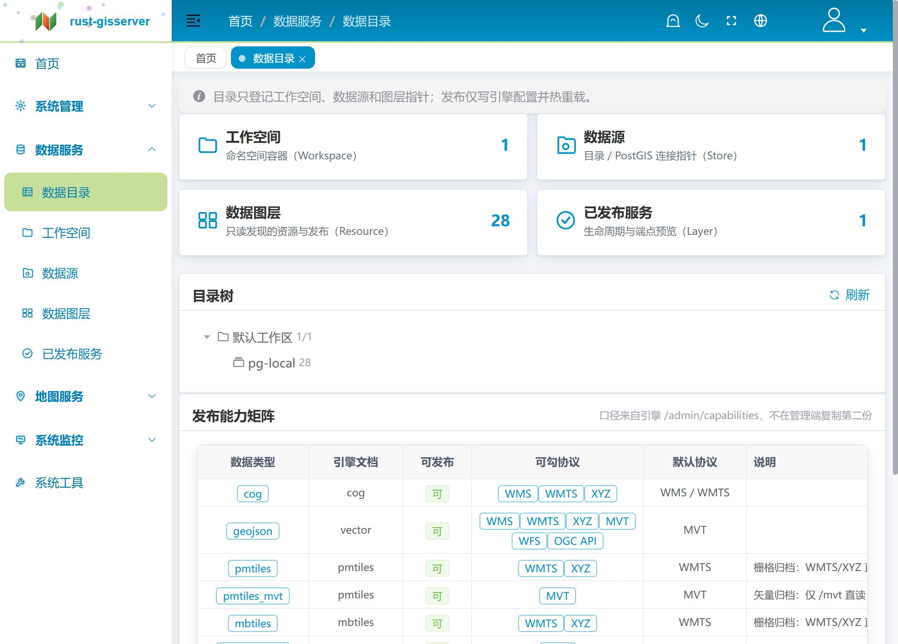

- 以树形结构展示工作空间、数据源、数据图层的层级关系
- 目录只登记工作空间、数据源和图层指针；发布操作仅写入引擎配置并触发热重载
- 支持刷新目录、维护与删除目录节点
- 可通过目录快速定位到对应工作空间或图层

### 3.2 工作空间

**菜单路径：数据服务 → 工作空间**

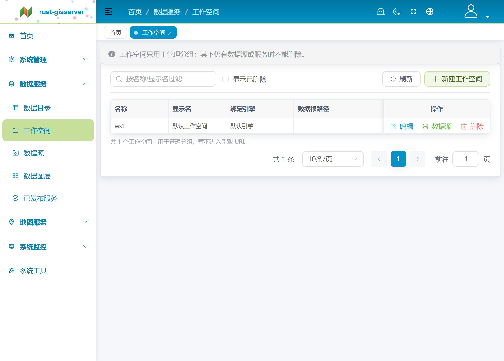

- 工作空间只用于管理分组；其下仍有数据源或服务时不能删除
- 系统内置「默认工作空间」（`ws1`），绑定默认引擎，既有服务与未分配数据都归属该工作空间
- 列表字段：名称、显示名、绑定引擎、数据根路径
- 操作：按名称/显示名过滤、显示已删除、刷新、新建工作空间、编辑、查看数据源、删除

### 3.3 数据源

**菜单路径：数据服务 → 数据源**

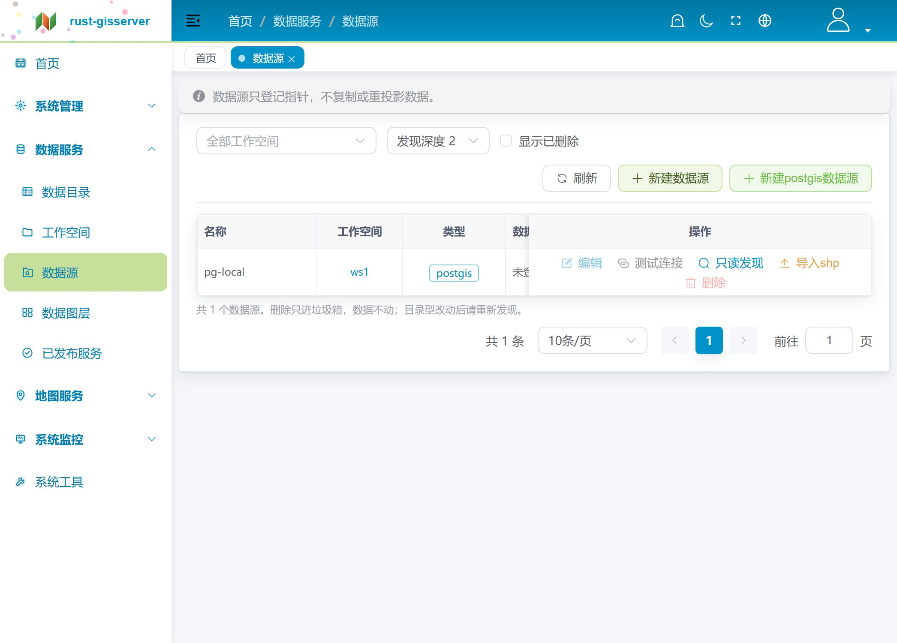

- 数据源只登记指针，不复制、不重投影数据
- 可按工作空间筛选，并可设置「发现深度」控制表/图层的发现层级
- 支持显示已删除的数据源，便于恢复或清理
- 常见类型：本地目录（Shapefile、GeoPackage、COG 等）、PostGIS 数据库、SHP 导入生成的数据表
- 常用操作：新增数据源、测试连接、发现数据表、编辑、删除

> 注意：PostGIS 数据源需正确填写主机、端口、数据库、用户名与密码，并选择与数据一致的坐标系。

### 3.4 数据图层

**菜单路径：数据服务 → 数据图层**

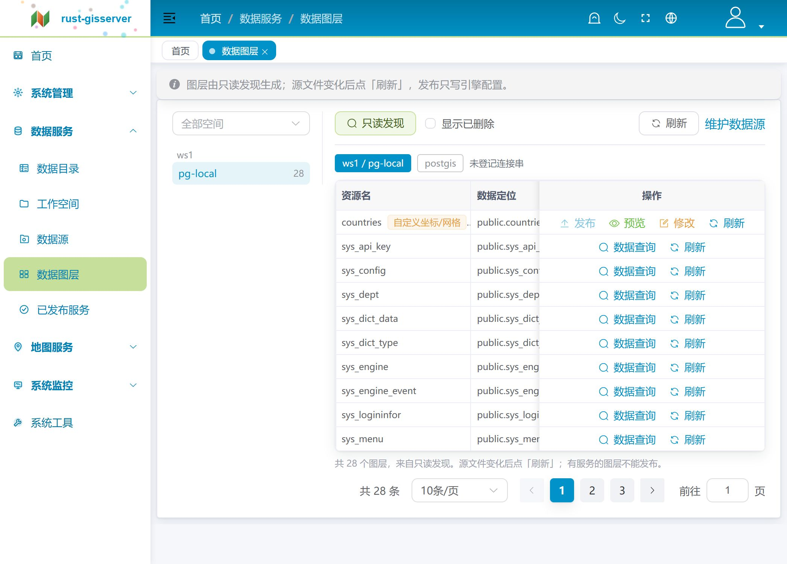

- 图层由数据源的只读发现生成；源文件或数据表变化后点击「刷新」重新发现
- 支持按空间/工作空间筛选，查看图层元数据（几何类型、坐标系、字段等）
- 发布图层只写入引擎配置，不修改原始数据
- 可配置样式（SLD / MVT 样式）后发布为 MVT、WMS、WFS 等服务

### 3.5 已发布服务

**菜单路径：数据服务 → 已发布服务**

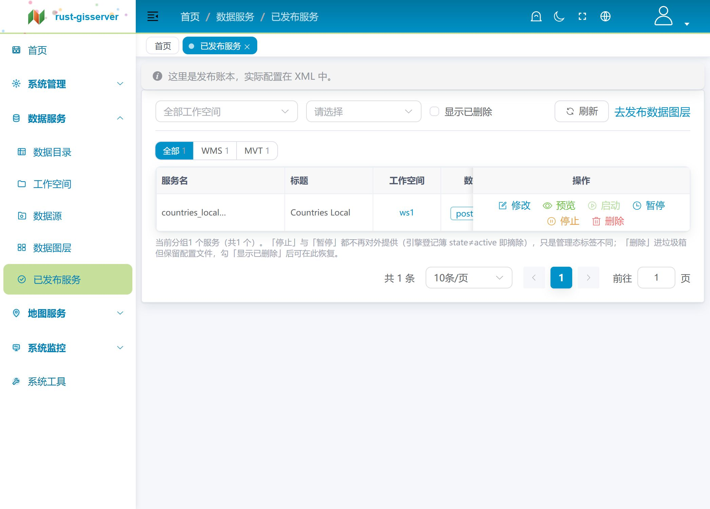

- 展示发布账本，实际服务配置保存在引擎 XML 中
- 支持按工作空间筛选、显示已删除记录、刷新列表
- 可查看服务地址、服务类型、发布时间等信息
- 支持下线、恢复、删除等生命周期操作

---

## 4. 地图服务

地图服务模块用于查看服务运行概况、管理已发布服务及其配套资源（样式、缓存、引擎、密钥等）。

### 4.1 运营仪表盘

**菜单路径：地图服务 → 运营仪表盘**

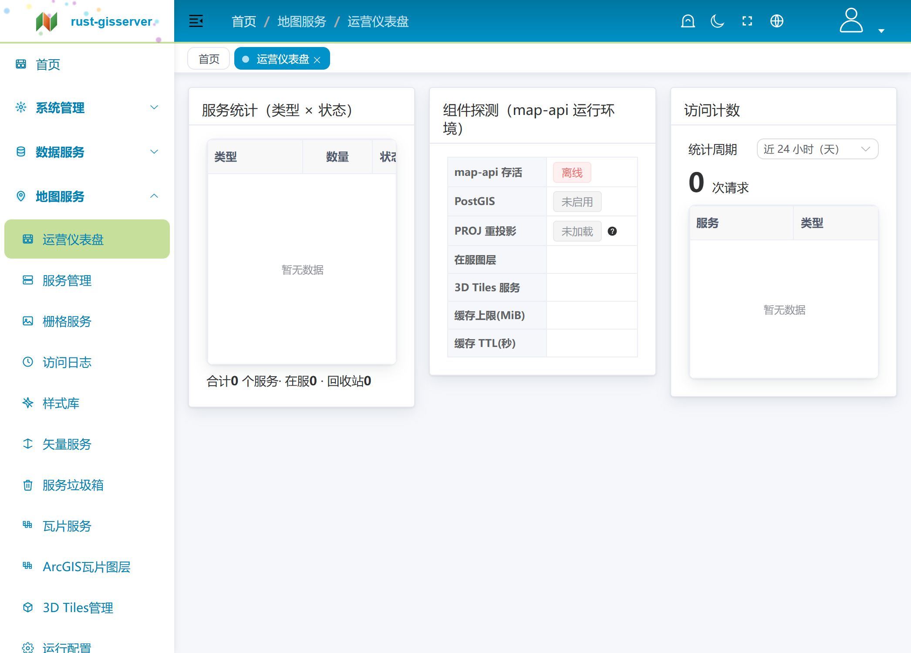

- **服务统计（类型 × 状态）**：按服务类型统计数量与状态分布
- **组件探测**：map-api 存活、PostGIS、PROJ 重投影、在服图层数、3D Tiles 服务、缓存上限与 TTL
- **访问计数**：按周期统计服务请求量

### 4.2 服务管理

**菜单路径：地图服务 → 服务管理**

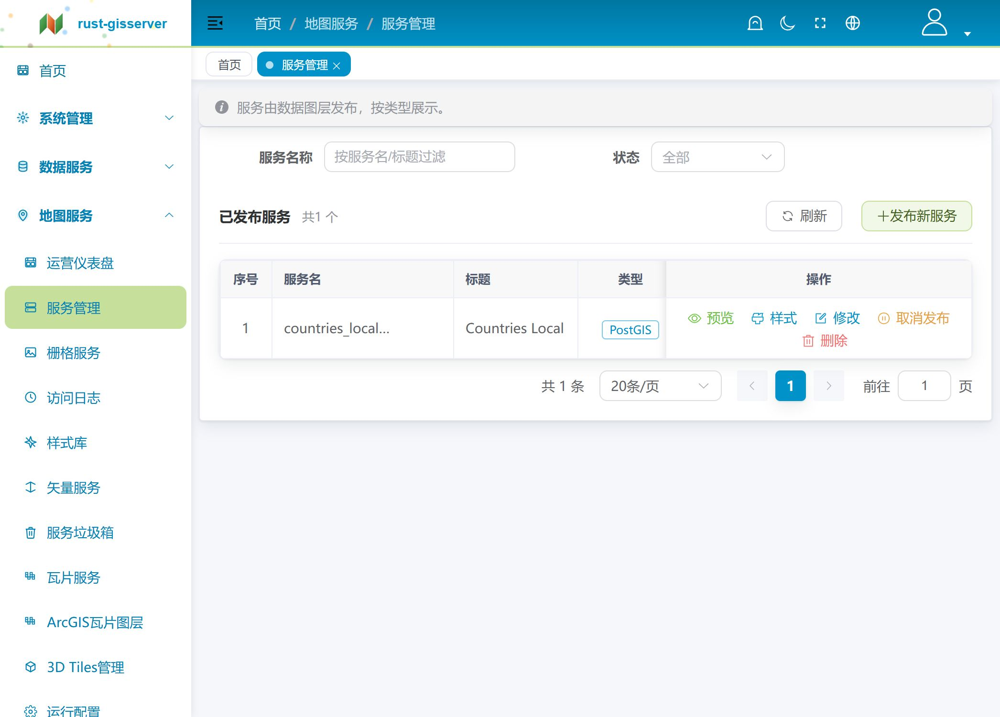

- 服务由数据图层发布，按类型展示
- 支持按服务名称、状态筛选
- 常用操作：启用/停用、重载配置、查看配置、预览、访问统计、健康检查

### 4.3 栅格服务

**菜单路径：地图服务 → 栅格服务**

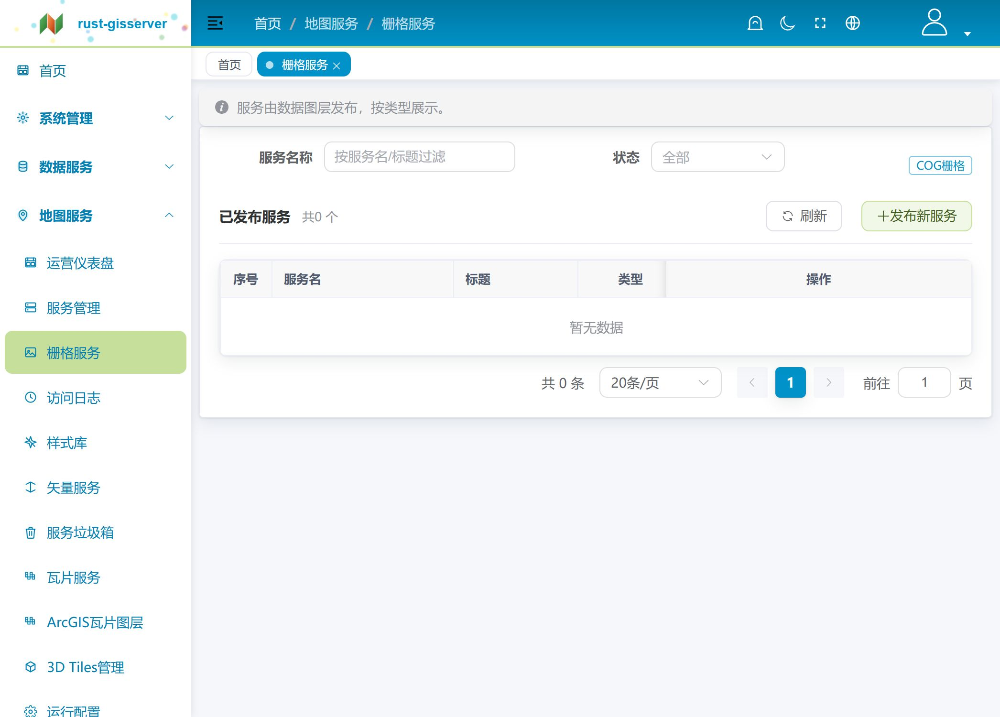

- 展示 COG 等栅格类型服务，布局与服务管理一致
- 支持按服务名称、状态筛选
- 可执行预览、重载、查看配置、下线等操作

### 4.4 访问日志

**菜单路径：地图服务 → 访问日志**

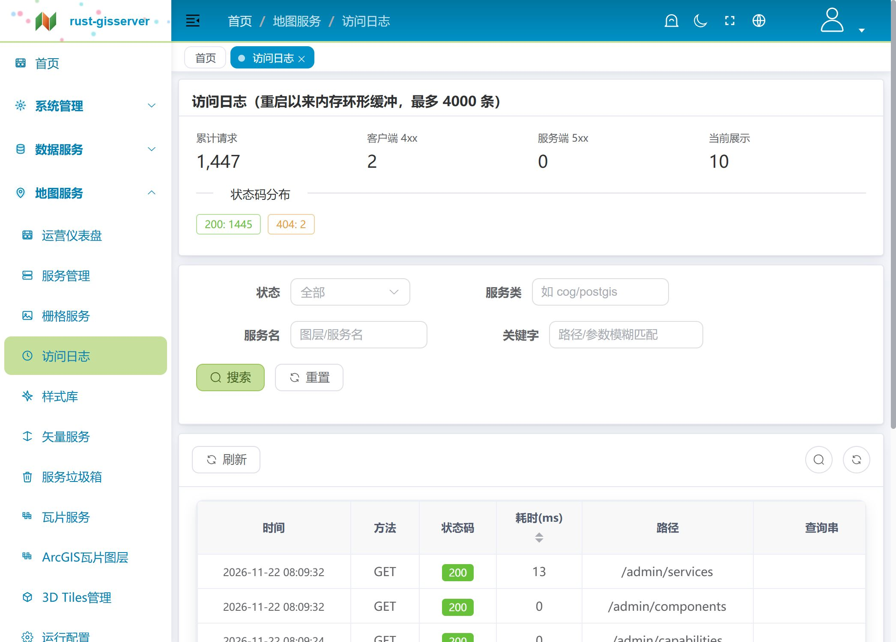

- 访问日志保存在内存环形缓冲区（重启后清空，最多 4000 条）
- 展示累计请求数、按服务的请求统计与最近访问明细
- 支持筛选、刷新与清空日志
- 用于排查服务调用量、响应状态与访问来源

### 4.5 样式库

**菜单路径：地图服务 → 样式库**

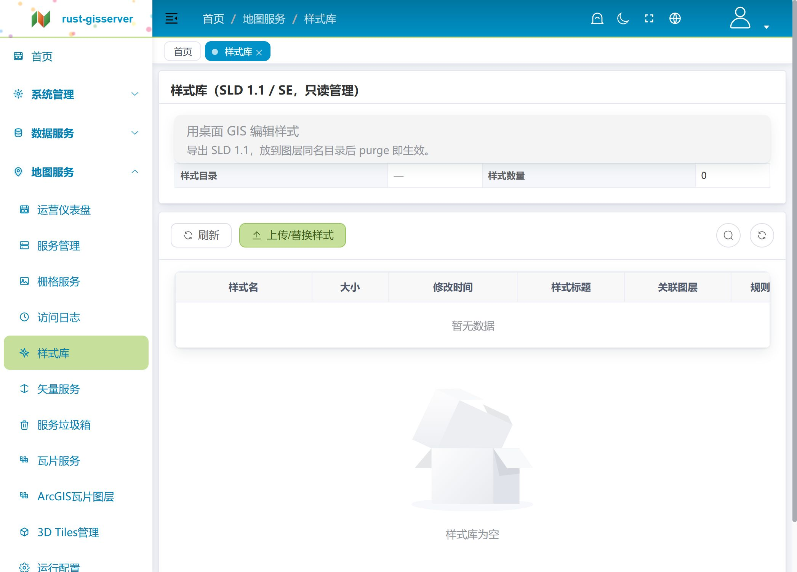

- 样式库用于管理 SLD 1.1 / SE 样式，供 WMS 出图与图例使用
- 推荐使用桌面 GIS 编辑样式：图层 → 样式 → 导出 SLD 1.1，放回图层目录后执行 purge / reload
- 支持查看样式目录、预览样式内容、导入/更新与删除样式
- SLD 仅影响 WMS 栅格出图与图例，不改变 MVT 瓦片内容

### 4.6 矢量服务

**菜单路径：地图服务 → 矢量服务**

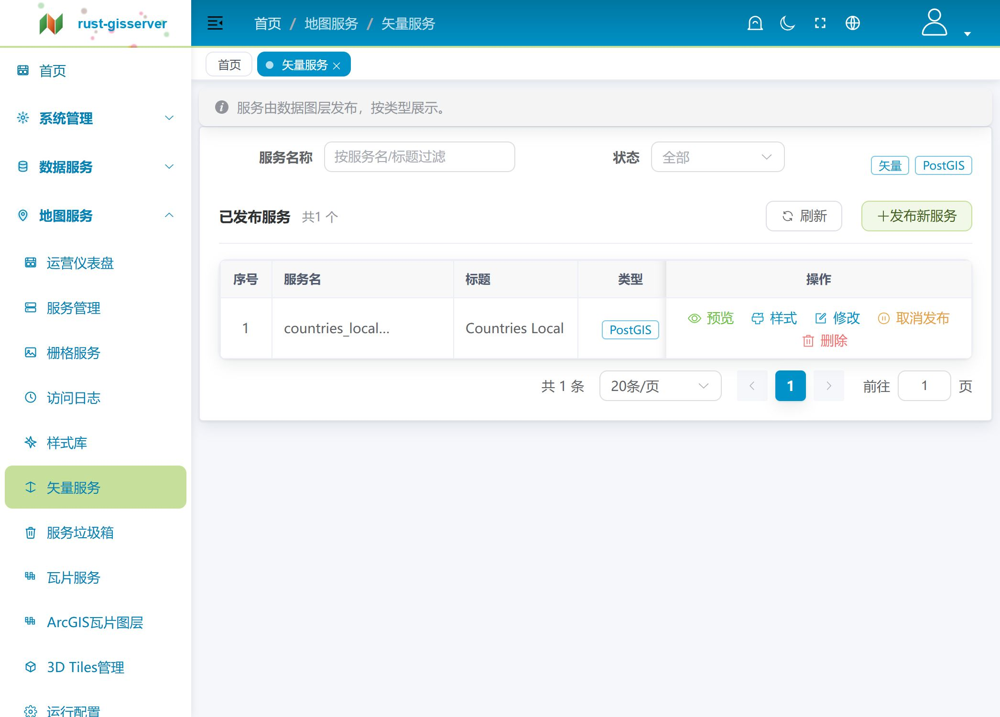

- 展示矢量类型服务（MVT / WMS / WFS）
- 支持按服务名称、状态筛选
- 可执行预览、重载、查看配置、下线等操作

### 4.7 服务垃圾箱

**菜单路径：地图服务 → 服务垃圾箱**

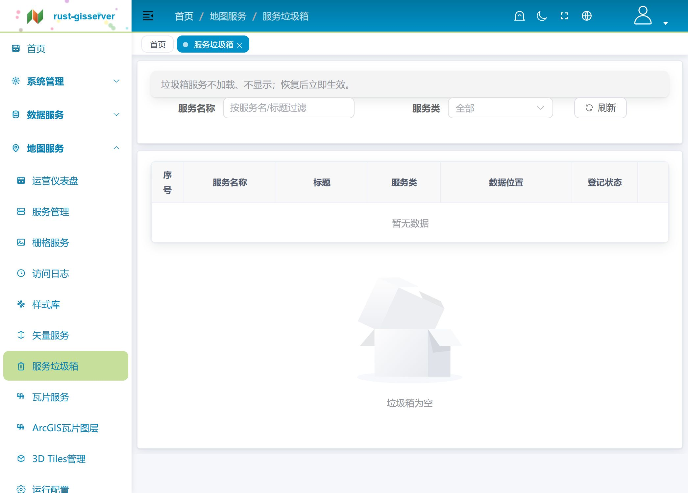

- 垃圾箱中的服务不加载、不显示；恢复后立即生效
- 支持按服务名称、服务类筛选与刷新
- 列表字段：服务名称、标题、服务类、数据位置、登记状态
- 可对服务执行恢复或彻底删除

### 4.8 瓦片服务

**菜单路径：地图服务 → 瓦片服务**

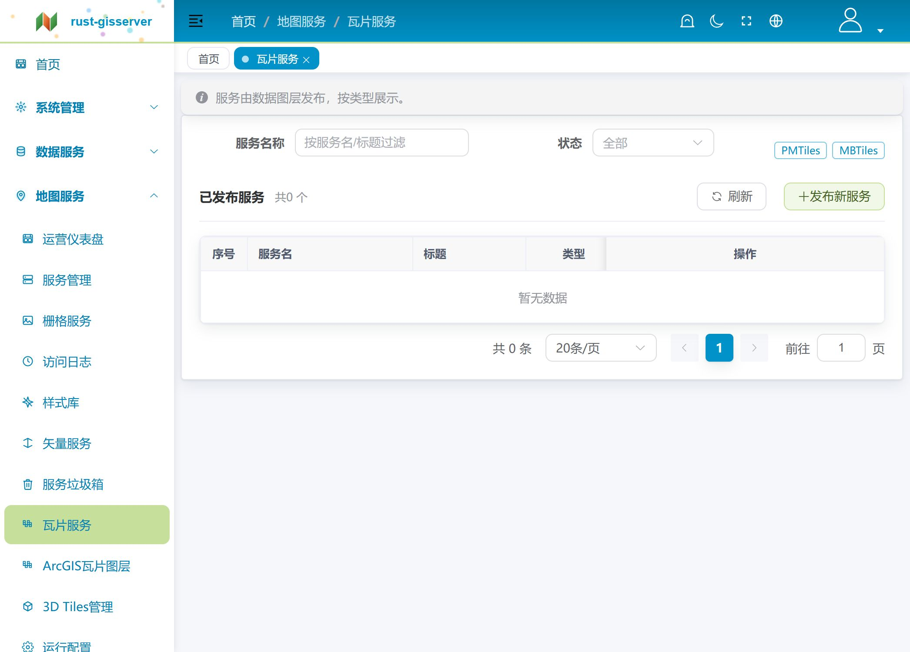

- 展示 PMTiles / MBTiles 等瓦片类型服务
- 支持按服务名称、状态筛选
- 可执行预览、重载、查看配置、下线等操作

### 4.9 ArcGIS 瓦片图层

**菜单路径：地图服务 → ArcGIS 瓦片图层**

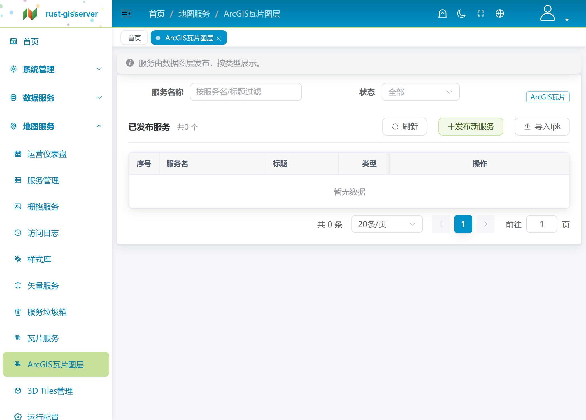

- 管理接入的 ArcGIS 瓦片图层服务
- 支持按服务名称、状态筛选
- 可执行预览、重载、查看配置、下线等操作

### 4.10 3D Tiles 管理

**菜单路径：地图服务 → 3D Tiles 管理**

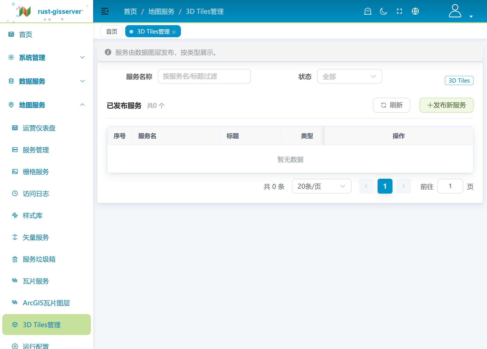

- 管理 3D Tiles 类型服务（如倾斜摄影、BIM 等三维数据集）
- 支持按服务名称、状态筛选
- 可执行预览、重载、查看配置、下线等操作

### 4.11 运行配置

**菜单路径：地图服务 → 运行配置**

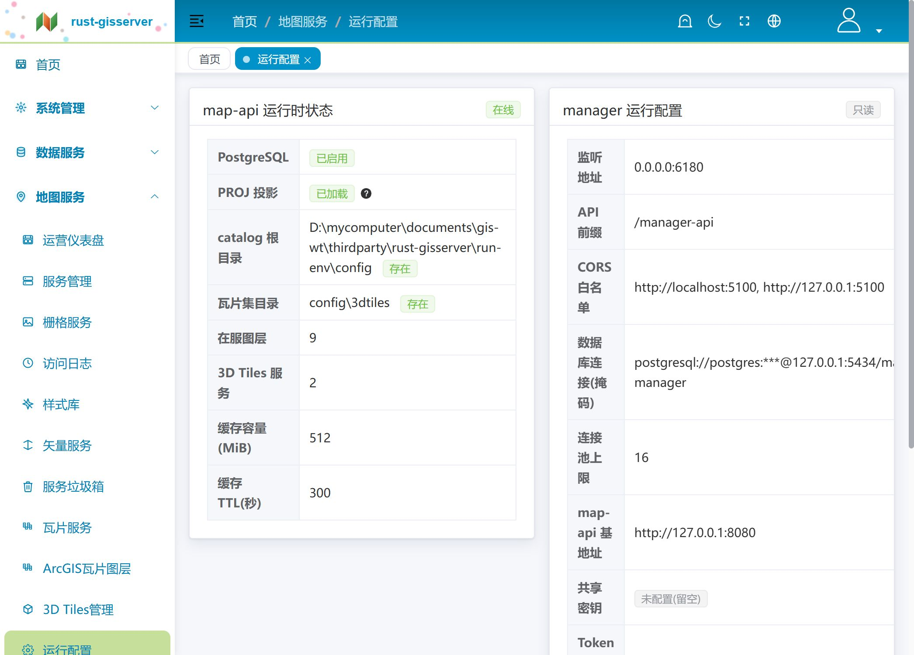

- 左侧展示 **map-api 运行时状态**：PostgreSQL、PROJ 投影、catalog 根目录、瓦片目录、在服图层、3D Tiles 服务、缓存容量与 TTL
- 右侧展示 **manager 运行配置**（只读）：监听地址、API 前缀、CORS 白名单、数据源连接（密码已掩码）、连接池上限、map-api 基地址、共享密钥、Token 配置
- 地址与密钥等敏感配置需在 `config/manager.xml`、`config/mapserver.xml` 中维护，页面不提供在线修改

### 4.12 缓存管理

**菜单路径：地图服务 → 缓存管理**

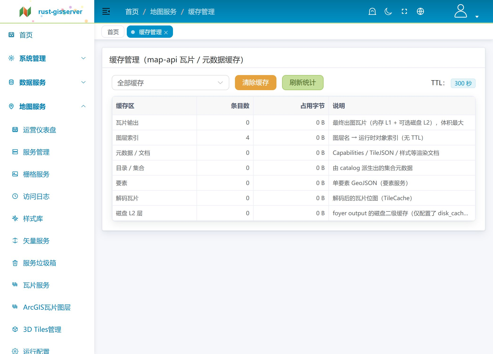

- 展示 map-api 瓦片 / 元数据缓存的各个缓存区：瓦片输出、图层索引、元数据/文档、目录/集合、要素、解码瓦片、磁盘 L2 层
- 列表字段：缓存区、条目数、占用字节、说明
- 支持按缓存区筛选、清除缓存、刷新统计，并显示当前 TTL

### 4.13 服务引擎管理

**菜单路径：地图服务 → 服务引擎管理**

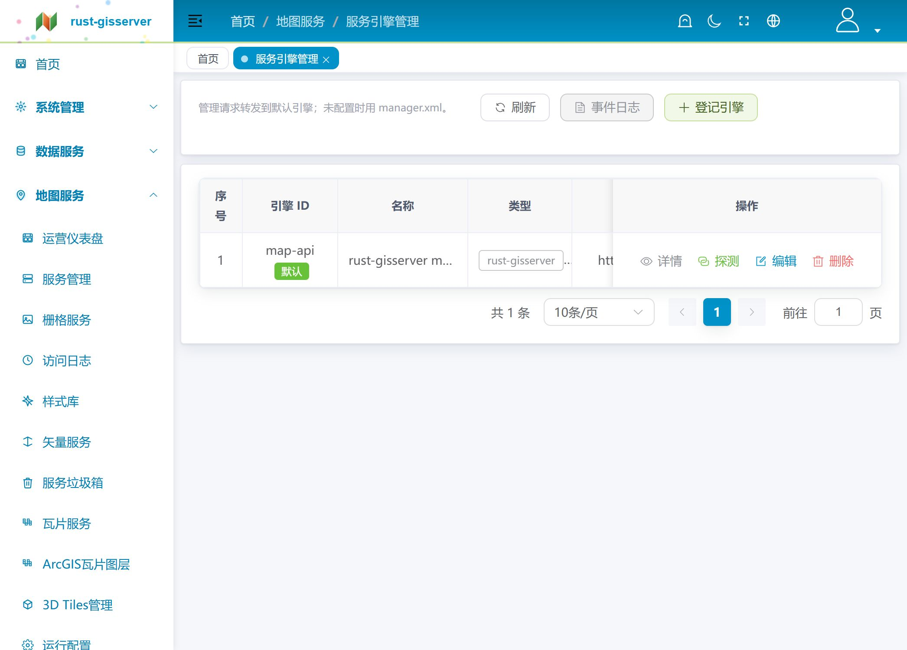

- 管理请求转发到默认引擎；未配置时使用 `manager.xml`
- 列表字段：引擎 ID、名称、类型、地址（URL）
- 操作：查看详情、探测连通性、编辑、删除；支持登记新引擎与查看事件日志
- `map-api` 为内置默认引擎

### 4.14 API Key 管理

**菜单路径：地图服务 → API Key 管理**

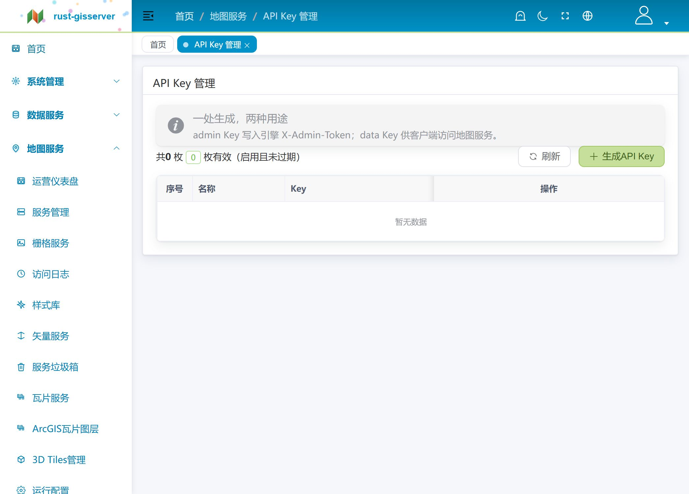

- 一处生成，两种用途：
  - `admin Key`：写入请求头 `X-Admin-Token`，用于管理接口
  - `data Key`：供客户端访问地图服务
- 支持生成、启用/停用、删除 API Key
- 列表显示名称、Key、状态与有效期；仅“启用且未过期”的 Key 计为有效

---

## 5. 系统监控

### 5.1 在线用户

**菜单路径：系统监控 → 在线用户**

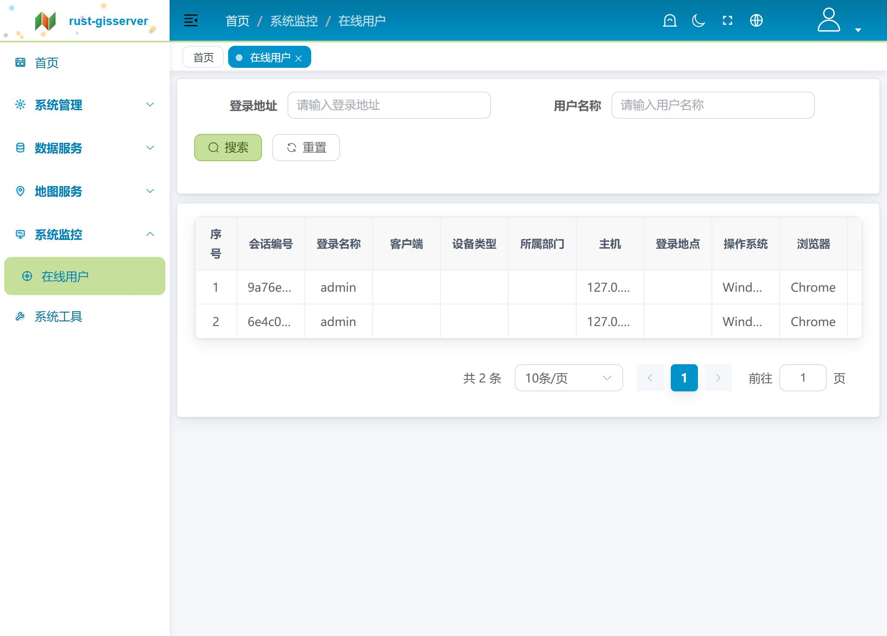

- 展示当前登录会话：会话编号、登录名称、客户端、登录地址、登录时间
- 支持按登录地址、用户名称查询
- 可对单个用户执行「强制下线」，也可勾选多条记录批量强退

### 5.2 操作日志

**菜单路径：系统管理 → 日志管理 → 操作日志**

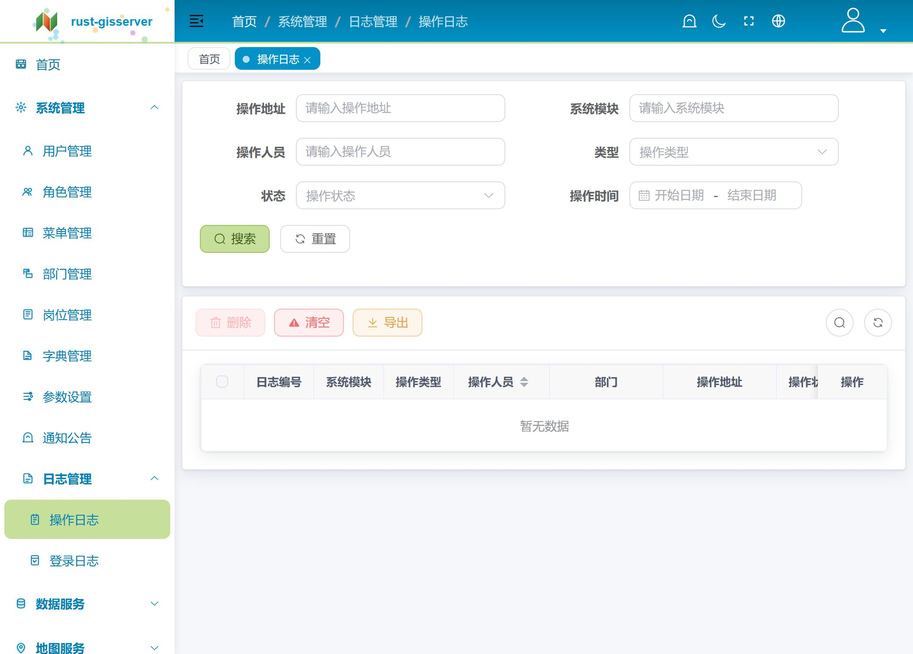

- 记录关键操作：操作地址、系统模块、操作人员、操作类型、操作状态、操作时间
- 支持条件查询、查看详情、删除、导出

### 5.3 登录日志

**菜单路径：系统管理 → 日志管理 → 登录日志**

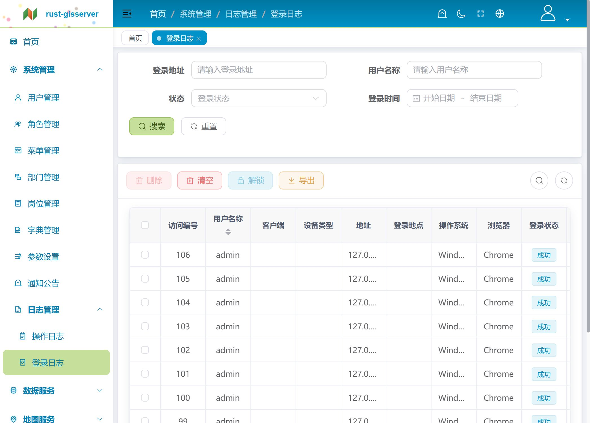

- 记录登录成功与失败：登录地址、用户名称、登录状态、登录时间
- 支持查询、删除、清空、导出
- 对因密码错误被锁定的账号，可使用「解锁」恢复登录

---

## 6. 通用操作与注意事项

1. **语言切换**：点击顶部地球图标，在中文 / English 之间切换，菜单与页面文字同步切换。
2. **全屏**：点击顶部全屏图标进入全屏，再次点击退出全屏。
3. **主题**：点击月亮/太阳图标切换浅色与深色主题。
4. **标签页**：点击标签快速切换页面，右键可关闭当前、关闭其他。
5. **用户菜单**：点击右上角头像可进入个人中心、布局设置或退出登录。
6. **配置生效**：修改图层/服务配置后，建议在服务管理中执行「重载」，或使用管理端热重载能力，使配置立即生效。
7. **数据安全**：删除数据源、图层或服务前，请确认引用关系，必要时先备份配置。
